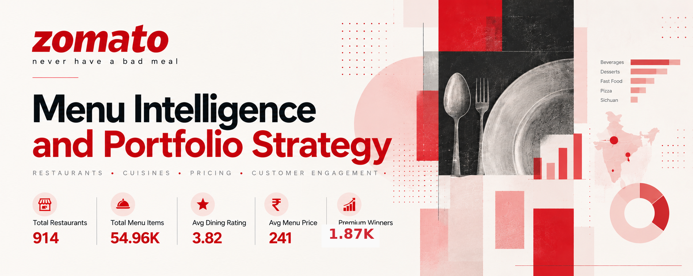
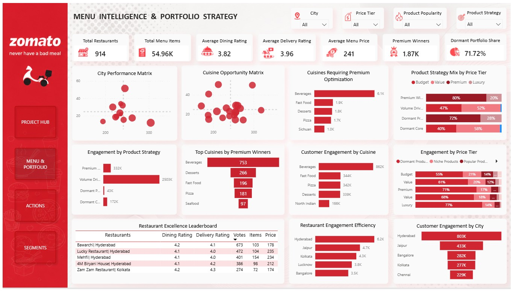

<div align="center">

# Zomato Menu Intelligence & Portfolio Strategy

**Power BI · Menu Intelligence · Pricing Strategy · Customer Engagement · Portfolio Management**



[**Live Power BI Dashboard**](https://app.powerbi.com/view?r=eyJrIjoiNjRkZTAwNzQtMGNkNi00NTFjLTg1YjEtOGI3NWZlMmEzZDcxIiwidCI6ImM2ZTU0OWIzLTVmNDUtNDAzMi1hYWU5LWQ0MjQ0ZGM1YjJjNCJ9) · [**Dataset Source**](https://www.kaggle.com/datasets/narsingraogoud/zomato-restaurants-dataset-for-metropolitan-areas)

</div>

---

## ■ Project at a Glance

This project treats the Zomato menu as a **product portfolio**, not simply as a collection of restaurant listings. The analysis connects **pricing position, customer engagement and product popularity** to identify which menu items should be scaled, premiumized, optimized or rationalized.

| Metric | Current dashboard value |
|---|---:|
| Restaurants | **914** |
| Menu Items | **54.96K** |
| Average Dining Rating | **3.82** |
| Average Delivery Rating | **3.96** |
| Average Menu Price | **₹241** |
| Premium Winners | **1.87K** |
| Dormant Portfolio Share | **71.72%** |

The project is built to demonstrate **technical Power BI execution, structured analytical reasoning and business decision-making** in one end-to-end workflow.

> **Refresh note:** The dashboard and repository were updated after correcting the Value Price Tier boundary to **≤ ₹300**. The current figures shown above reflect the refreshed PBIX.

---

## 03 — Data at a Glance

| Attribute | Detail |
|---|---|
| **Source** | Kaggle — *Zomato Restaurants Dataset for Metropolitan Areas* |
| **Publisher** | Narsing Rao Goud |
| **Source size** | **123,657 rows × 12 columns** |
| **Geographic coverage** | **13 Indian metropolitan areas** |
| **Data grain** | **Menu-item / restaurant-level records** |
| **Primary analytical table** | `zomato` |
| **Core entities** | Restaurants, menu items, cuisines, cities, ratings, votes, prices |
| **Analytical platform** | Microsoft Power BI |
| **Report canvas** | 1280 × 720 |
| **Primary segmentation** | Price Tier + Popularity Segment → Product Strategy Segment |

The source is a **menu-item / restaurant-level dataset** containing restaurant identity, dining and delivery ratings, votes, cuisine, location, menu-item, best-seller status and menu price. The analysis uses these attributes to evaluate customer engagement, pricing position and portfolio productivity.

The raw source dataset is not redistributed in this repository.

**Source:** https://www.kaggle.com/datasets/narsingraogoud/zomato-restaurants-dataset-for-metropolitan-areas

---

## ■ The Business Problem

A large menu does not automatically create a strong menu portfolio. Restaurants and marketplace operators need to understand:

- Which products generate meaningful customer engagement?
- How does price positioning relate to demand?
- Which products succeed because of volume versus premium positioning?
- Which expensive products receive little customer engagement?
- Which cuisines, restaurants and cities provide useful benchmarks?
- Where should the portfolio be expanded, optimized or rationalized?

The project therefore moves beyond descriptive reporting toward a **portfolio-management framework**.

---

## ■ Analytical Identity

The core analytical chain is:

> **Price Positioning + Customer Engagement → Product Strategy → Restaurant / Cuisine / City Intelligence → Portfolio Action**

The central idea is to evaluate each menu item through two lenses:

1. **Price Tier** — where the product sits in the pricing landscape.
2. **Popularity Segment** — how strongly customers engage with the product through votes.

Those dimensions are then combined into a third layer:

### Price Tier × Popularity Segment → Product Strategy Segment

| Product Strategy | Logic | Strategic interpretation |
|---|---|---|
| **Volume Drivers** | Budget / Value + Popular / High-Performing / Signature | Scale and protect proven demand |
| **Premium Winners** | Premium / Luxury + Popular / High-Performing / Signature | Strengthen premium positioning and profitability |
| **Dormant Premium** | Premium / Luxury + Dormant / Niche | Reposition, reprice or discontinue |
| **Dormant Core** | Budget / Value + Dormant / Niche | Rationalize and simplify |

This framework is the **central analytical contribution** of the project. It converts raw menu-level attributes into strategic product roles.

---

## ■ What the Analysis Found

### 1. The portfolio has a substantial dormant tail

**71.72% of menu items are represented in the dormant portfolio view.** That shifts the management question from simply finding popular products to understanding whether the long tail is creating value or unnecessary portfolio complexity.

### 2. Volume Drivers are the strongest engagement engine

The main dashboard shows approximately **2.50M customer votes** associated with Volume Drivers, compared with approximately **332K** for Premium Winners. This supports a dual growth logic: protect affordable high-demand products while selectively developing premium winners.

### 3. Premium success is concentrated

The report identifies **1.87K Premium Winners**. At the cuisine level, Beverages leads the Premium Winner view with **753** products, reinforcing that premiumization should be selective rather than universal.

### 4. Market performance is not uniform

Hyderabad leads the displayed customer-engagement ranking at approximately **803K votes** and also leads the restaurant engagement-efficiency view at approximately **6.2K votes per restaurant**. This supports city-specific portfolio planning rather than a single national strategy.

### 5. Portfolio productivity matters more than menu size

The project deliberately avoids treating assortment size as the objective. High-performing products and restaurants are used as benchmarks for focused menus, stronger engagement and more disciplined portfolio management.

---

## ■ Analytical Framework

### Layer 1 — Price Tier

The business-facing framework uses four pricing tiers:

| Tier | Business definition |
|---|---:|
| Budget | ≤ ₹150 |
| Value | ₹151–300 |
| Premium | ₹301–500 |
| Luxury | > ₹500 |

### Layer 2 — Popularity Segment

Popularity is classified using menu-item vote volume:

| Segment | Votes | Interpretation |
|---|---:|---|
| Dormant Products | 0 | No customer traction |
| Niche Products | 1–15 | Low but existing interest |
| Popular Products | 16–50 | Growing acceptance |
| High-Performing Products | 51–100 | Strong customer approval |
| Signature Products | 101+ | Highest engagement |

### Layer 3 — Product Strategy

The two dimensions above are combined through row-level DAX logic to create four actionable portfolio groups. This is what transforms a descriptive menu dataset into a strategic product portfolio framework.

---

## ■ Technical Architecture

### Power Query

The source CSV was intentionally retained close to its original structure. Power Query was used for:

- Source ingestion
- Header promotion
- Data-type standardization

No complex merge, append, grouping, pivoting or extensive row-level transformation was required.

### Data Model

The report uses a **single analytical table: `zomato`**.

There are no fact/dimension relationships or multi-table analytical joins. The source already contains the restaurant, cuisine, location, menu-item, rating, votes and pricing attributes required for the analysis.

Dedicated measure tables organize the DAX layer; they are **measure containers, not analytical tables participating in relationships**.

### DAX

The project uses calculated columns for the three-level segmentation framework and measures to quantify the resulting portfolio.

Representative strategic measures include:

- `Premium Winners Count`
- `Premium Winner Share %`
- `Volume Drivers`
- `Dormant Premium Count`
- `Dormant Product %`
- `Engagement per Restaurant`

The documentation intentionally focuses on DAX that demonstrates **segmentation, filter context, portfolio composition and normalized engagement**, rather than listing every basic aggregation measure.

---

## ■ Representative DAX

### Premium Winner Share %

```DAX
Premium Winner Share % =
DIVIDE(
    [Premium Winners Count],
    DISTINCTCOUNT(Zomato[Item Name]),
    0
)
```

### Volume Drivers

```DAX
Volume Drivers =
CALCULATE(
    DISTINCTCOUNT(Zomato[Item Name]),
    Zomato[Product Strategy Segment] = "Volume Drivers"
)
```

### Dormant Premium Count

```DAX
Dormant Premium Count =
CALCULATE(
    DISTINCTCOUNT(Zomato[Item Name]),
    Zomato[Product Strategy Segment] = "Dormant Premium"
)
```

### Dormant Product %

```DAX
Dormant Product % =
DIVIDE(
    CALCULATE(
        DISTINCTCOUNT(Zomato[Item Name]),
        Zomato[Popularity Segment] = "Dormant Products"
    ),
    DISTINCTCOUNT(Zomato[Item Name])
)
```

### Engagement per Restaurant

```DAX
Engagement per Restaurant =
DIVIDE(
    [Total Votes],
    [Total Restaurants],
    0
)
```

The complete segmentation logic and selected analytical measures are documented in [`docs/dax_logic.md`](docs/dax_logic.md).

---

## ■ Report Architecture

The Power BI report contains four primary business-facing pages:

| Page | Purpose |
|---|---|
| **Project Hub** | Business context, objectives and report navigation |
| **Menu & Portfolio** | Main analytical dashboard across pricing, engagement, cuisine, city and restaurant performance |
| **Actions** | Executive recommendations and strategic priorities |
| **Segments** | Segmentation methodology, thresholds and business definitions |

Additional tooltip pages support the interactive report experience.

The README intentionally showcases **only the main analytical dashboard**. The complete visual report is preserved under [`images/`](images/), while the full dashboard export is available under [`deliverables/`](deliverables/).

---

## ■ Dashboard Preview

### Main Analytical Dashboard



The main page combines KPI monitoring with city performance, cuisine opportunity, premium optimization, product-strategy mix, customer engagement, restaurant benchmarking and price-tier analysis.

### Supporting Pages

- [`Project Hub`](images/01_project_hub.jpg)
- [`Executive Action Plan`](images/03_executive_action_plan.jpg)
- [`Segmentation Framework & Business Definitions`](images/04_segmentation_framework.jpg)

The repository also contains the full dashboard PDF in [`deliverables/dashboard_export.pdf`](deliverables/dashboard_export.pdf).

---

## ■ From Analysis to Business Action

The analysis is translated into ten strategic decision areas:

1. **Scale proven menu winners** rather than expanding the entire portfolio indiscriminately.
2. **Use a dual growth strategy** built around Volume Drivers and Premium Winners.
3. **Use Hyderabad as an innovation and launch market** based on observed engagement and efficiency performance.
4. **Rationalize Dormant Core and Dormant Premium products** to reduce portfolio complexity.
5. **Build menus around demonstrated customer demand** rather than assortment size.
6. **Replace uniform national strategies with city-specific portfolio planning.**
7. **Expand premium selectively** where customer demand and willingness to pay are already visible.
8. **Use high-performing local restaurant partners as operational benchmarks.**
9. **Protect dining and delivery service quality** as a customer-experience lever.
10. **Turn the segmentation framework into a continuous portfolio-management process.**

The complete evidence-to-recommendation logic is documented in [`docs/executive_recommendations.md`](docs/executive_recommendations.md), with the original report preserved in [`deliverables/executive_action_plan.pdf`](deliverables/executive_action_plan.pdf).

---

## ■ Analyst Mindset Behind the Project

The project is structured around a decision-oriented sequence:

**Business Question → Data → Preparation → Analytical Framework → Evidence → Interpretation → Decision**

The dashboard is therefore designed to answer more than *what happened*:

- **Where is the opportunity?**
- **What customer signal supports it?**
- **Which products or markets deserve investment?**
- **What should be scaled, optimized or removed?**
- **How can the framework be reused for continuous portfolio management?**

That is the main distinction between this project and a conventional restaurant dashboard.

---

## ■ Repository Structure

```text
Zomato-Menu-Intelligence-Portfolio-Strategy/
│
├── README.md
├── images/
│   ├── 00_title_card.png
│   ├── 01_project_hub.jpg
│   ├── 02_menu_portfolio.jpg
│   ├── 03_executive_action_plan.jpg
│   └── 04_segmentation_framework.jpg
│
├── docs/
│   ├── analytical_methodology.md
│   ├── data_model.md
│   ├── dax_logic.md
│   ├── executive_recommendations.md
│   ├── qa_notes.md
│   ├── report_architecture.md
│   └── source_and_data.md
│
├── powerbi/
│   ├── Zomato_Menu_Intelligence_Portfolio_Strategy.pbix
│   └── README.md
│
├── deliverables/
│   ├── dashboard_export.pdf
│   └── executive_action_plan.pdf
│
└── data/
    └── README.txt
```

---

## ■ Tools

**Power BI Desktop · Power Query · DAX · Data Segmentation · Dashboard Design · Business Intelligence · Portfolio Analytics**

---

## ■ Explore the Project

**Live Power BI Dashboard**  
https://app.powerbi.com/view?r=eyJrIjoiNjRkZTAwNzQtMGNkNi00NTFjLTg1YjEtOGI3NWZlMmEzZDcxIiwidCI6ImM2ZTU0OWIzLTVmNDUtNDAzMi1hYWU5LWQ0MjQ0ZGM1YzJjNCJ9

**Dataset Source**  
https://www.kaggle.com/datasets/narsingraogoud/zomato-restaurants-dataset-for-metropolitan-areas

---

## Author

**Debanjan Biswas**  
Data Analyst | Excel | Power BI | SQL | Python  
Email: <bishwasdebanjan99@gmail.com>  
LinkedIn: [linkedin.com/in/biswas-debanjan-2ab011148](https://www.linkedin.com/in/biswas-debanjan-2ab011148/)

This project was developed as a practical Power BI and Data Analytics portfolio project, with a focus on turning hands-on technical work into a business-oriented analytical solution.

---

## Project Direction

The purpose of this project was to move beyond a conventional restaurant or menu-performance dashboard.

The analysis connects **menu pricing, customer engagement, product popularity, restaurant performance, cuisine behavior and city-level differences** into one portfolio-management view.

The resulting decision chain is:

> **Understand where customer engagement exists → determine how price positioning interacts with demand → classify products by strategic role → identify portfolio opportunities and inefficiencies → prioritize the right commercial action.**
